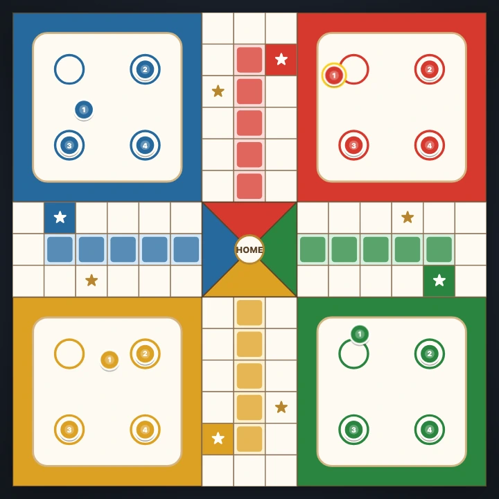

# Ludo Royal — 4-House Pachisi Strategy

**Ludo Royal** is an interactive 4-House Pachisi / Ludo strategy board game built with **TypeScript, SVG, and `statebinderk`**, featuring three tactical AI bot personalities and a Royal Navy & Gold tabletop interface.



---

## Features & Game Mechanics

- **Authentic 15×15 Pachisi / Ludo Board**:
  - 52-cell outer loop, 8 safe star squares (`★`), 4×5 colored home-stretch lanes, corner yards, and center Home Goal triangles.
  - Complete rules: Roll a **6** to deploy from the yard, **three consecutive 6s** penalty, safe-star immunity, opponent token capture (+1 bonus roll), exact roll for Home Goal entry (+1 bonus roll), and stacked-token offsets.
- **3 Tactical AI Bot Personalities**:
  - **Emerald Bot (`bot-aggressive`)**: Prioritizes hunting and capturing opponent tokens.
  - **Amber Bot (`bot-safe`)**: Prioritizes landing on safe star squares (`★`) and advancing into the home stretch.
  - **Sapphire Bot (`bot-balanced`)**: Balances token deployment, captures, and safe progression.
- **Fine-Grained Reactive UI via [`statebinderk`](https://www.npmjs.com/package/statebinderk)**:
  - `StateVarList<number>` binds all 9 dice pips (`#dot-0`..`#dot-8`) and home counters (`#player-home-count-*`).
  - `StateVarList<TokenVisualBinding>` binds all 16 tokens (`#token-red-0`..`#token-blue-3`) directly to SVG coordinates, stack offsets, and selectable pulse rings.
  - `MultiStateVar<TurnBannerBinding>` synchronizes the active house badge, turn prompt, dice readiness, and house cards.

---

## Project Structure

```text
Ludo/
├── index.html          # App entry point
├── package.json        # Vite + TypeScript + statebinderk
└── src/
    ├── types.ts        # Core types (LudoColor, LudoToken, LudoPlayer, LudoMoveOption)
    ├── ludoBoardData.ts# 15x15 grid coordinates for 52 track cells, safe stars, home lanes, yards
    ├── binder.ts       # Reactive statebinderk bindings for 16 tokens, 9 dice pips, and HUD
    ├── ludoEngine.ts   # Dice state machine, capture/safe rules, home entry, AI bots, localStorage
    ├── boardView.ts    # SVG 15x15 board renderer, workspace layout, and rules modal
    ├── main.ts         # Session bootstrap and event listeners
    └── App.css         # Royal Pachisi navy & gold tabletop theme
```

---

## Getting Started

```bash
git clone https://github.com/mk314k/Ludo.git
cd Ludo
npm install
npm run dev
```

## License

MIT License — see [LICENSE](./LICENSE) for details.
